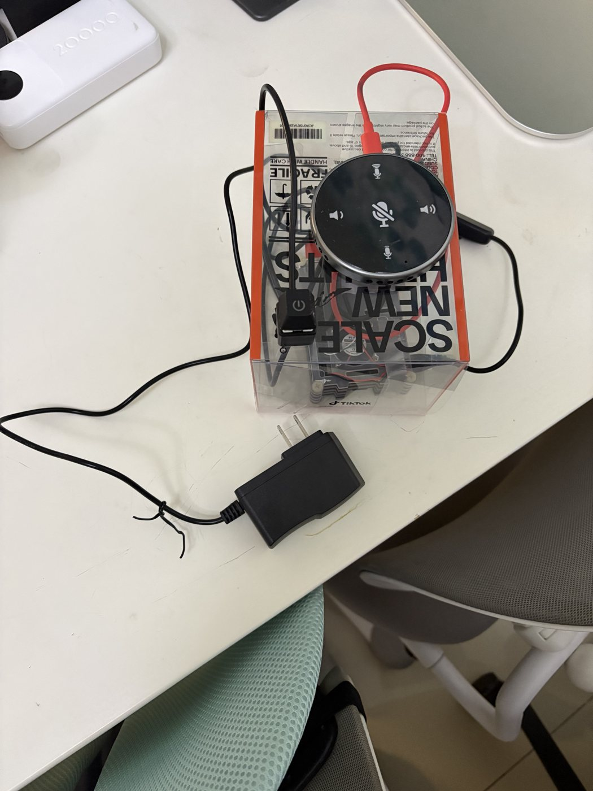
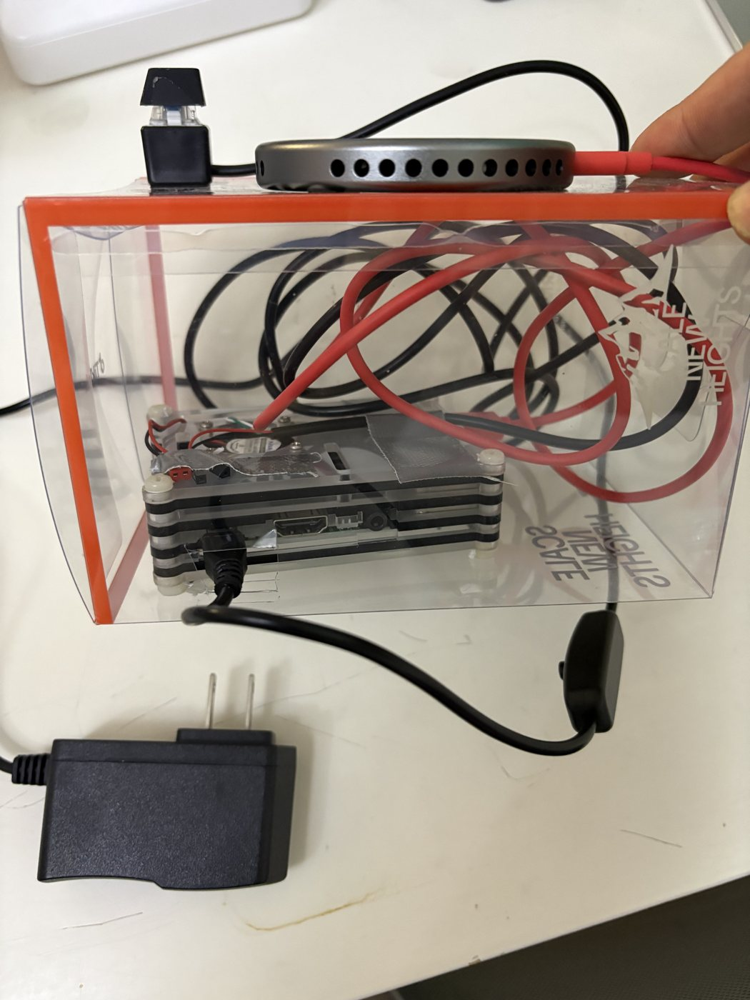

# kid-qa-box · 给孩子的 AI 问答机

<p>


</p>

一个按钮。按住说话，松开就回答，**1s 左右开始回答**。没有屏幕，没有唤醒词，不能装 App，不能刷视频。

**成本：1 小时 + 约 420 元。**

## 为什么做这个

我儿子该用上 AI 了。

但他不该通过一块屏幕用上它。

现在的现实是：手机上任何一个入口，最后都会滑进短视频。我不能一边说"你要多动脑"一边把一台多巴胺机器塞给他。而现成智能音箱的问题又相反——它太封闭，答案很长、内容不可控、麦克风常开、记不住上一句话，我改不了它的任何一行。

所以我做了这个东西：**能力上给足（真·大模型，不是关键词问答），形式上做减法（一个按钮，说完就停）**。

它只有一个功能，这个功能就是它的全部边界：

- 想问了，按住按钮说。松开就说完了。
- 它答，先给结论，两句以内，35 个字。
- 答完就安静。没有推荐、没有下一个、没有"你可能还喜欢"。

孩子跟 AI 打交道这件事我不打算拦。我只想决定**它以什么形态出现在他面前**——是一个会一直勾着他往下滑的东西，还是一个他说一句、答一句、然后就去搭积木的东西。

顺便说三个私心：

- 他反复问恐龙，一周问 12 次。我想知道第 13 次他在问什么。
- 我不想让他觉得 AI 是"手机里的东西"，它可以是桌上一个盒子。
- 我想让他看见：**东西是可以自己做出来的。**

## 为什么不用成品音箱

家里有小爱和 Siri，都试过。不是我挑剔，是三件硬伤。

**1. 智商不够。**
老一代音箱做的是“识别关键词 → 检索一条答案”。你问“为什么天是蓝的”，它念一段百科；
你接着问“那为什么傍晚是红的”，它答不上来——因为它没有推理，只有一个答案库。
更常见的是“我还在学习中哦”。孩子第一次听会笑，第三次就懒得问了。

**2. 不能进化。**
它明天更新成什么样，你只能接受。
而孩子是在变的：小时候问“这是什么”，大一点问“为什么”，再大一点会问“如果……会怎样”。
我想跟着他调的是 prompt 里的一句话：

> 只说 2 句，不超过 35 个字。先给结论，再补一句原因。

他大一点，我把 35 改成 80。他开始追问了，我让它先反问一句再答。
**这三行字能改写，比多一个喇叭、多一块屏重要得多。**

**3. 对话不归你。**
这是我最在意的一条。孩子问的每一个问题，都存在它的账号里，和这台设备、这个家庭绑在一起，攒成一份记录。
你不知道它留多久、给谁、拿来干什么。而且你删不干净——删掉播放历史，不等于删掉后台的日志。
这台的记录就在你自己硬盘的一个文件里（`aibox.jsonl`），`rm` 一条命令就没了。
它也不需要给孩子注册任何账号。

> 但我不打算把这条写成“数据不出门”：云端链路下那句话不成立（录音和文字会到
> 阿里云和 DeepSeek）。省掉的是“被锁在某家的账号和画像里”，不是“没出过家门”。
> 完整链路和边界在下面「对话去哪了」一节。

还有几条，单看都不致命，凑一起就很难受：

- **接不上话。** 他问“那恐龙呢”，音箱不记得上一句说的是恐龙。
- **一直在听。** 唤醒词意味着麦克风常开，而“关掉麦克风”这个动作，小孩自己不会做。这台是按键才录。
- **答案太长、语速不对。** 给大人做的东西，节奏对不上一个六岁孩子的注意力。
- **它会把你往里勾。** 推荐、会员、装 App。我只想要一个“问完就停”的东西。

公平地说：这两年新出的音箱也接了真·大模型，智商这一条已经不成立了。
但“能不能改”和“对话归谁”没变——那还是别人家的产品，规则写在别人的服务器上，记录存在别人的账号里。

所以这台的定位不是“更好的智能音箱”，是 **一个你能拆开改、也能随时清空的东西**：
硬件 420 块，代码在你硬盘上，性格写在 `config.json` 的 `system_prompt` 里，
对话日志在你自己的文件里。

## 成本

### 硬件（约 420 元）

| 件 | 规格 | 价 |
|---|---|---|
| 树莓派 3B | 1GB 内存，够用，别买新的 4B/5 | 300 |
| USB 麦克风音响一体机 | 免驱，插上就认。我的是 BY Y02 | 68 |
| 按钮 | 自复位轻触/大按钮 + 杜邦线 | 3 |
| microSD 卡 | 16GB 就够（系统 4G + 代码） | ~20 |
| 电源 | 5V 2.5A，带开关的线 | ~15 |
| 外壳 | 亚克力盒或塑料盒，自己开孔 | ~15 |
| | **合计** | **~420** |

前三个是我实际付的钱，后三个是估价（家里现成的话就不算）。卡和电源别抠，
电源不稳会导致 USB 声卡随机掉线。

不需要屏幕、不需要风扇（实测 39.7°C）、不需要电池。

### 接口 Key（两个，都要自己申请）

| 服务 | 用来做什么 | 用什么型号 | 花钱 |
|---|---|---|---|
| 阿里云百炼（DashScope） | 语音识别 + 语音合成 | `paraformer-realtime-v2` / `cosyvoice-v2` | 新用户有免费额度，用完后按量计费 |
| DeepSeek | 回答问题 | `deepseek-chat` | 按 token 计费，充 10 元能用很久 |

两个都支持支付宝，**个人实名即可，不需要企业认证**。LLM 也可以用任意 OpenAI 兼容接口替换（通义、Kimi、豆包、本地 Ollama 都行），改 `config.json` 里的 `base_url` 就行。

### 使用成本

**一次对话约 1 分钱。**

拆开是：识别 3~5 秒音频 + 一次短 LLM 调用 + 35 字语音合成。按官方价目估算，一天问 50 次是几毛钱。以实际账单为准，我不替你保证价格不变。

## 关于这个外壳

我当时赶着出差，外壳是凑合的——透明亚克力盒、扎带、双面胶。能用，不好看。

你们自己提升一下审美：木质盒、3D 打印、乐高拼，哪怕就是一个正经收纳盒开三个孔
（麦克风朝上、喇叭朝前、按钮在顶），都比我这个强。

功能上只有一件事必须注意：**USB 麦克风别贴着喇叭**，会啸叫。我这版是靠盒子厚度隔开的。

## 三个关键设计（比技术选型重要）

**1. 先给结论，再展开一句。**
system prompt 里写死：只说两句，不超过 35 字，先答再补一句原因。这一条决定孩子会不会听完。

**2. 必须用物理按钮，不能用唤醒词。**
对小孩来说"按键"这个动作是可学习的、有仪式感的；对家长来说它意味着**麦克风默认关闭**。

**3. 多轮记忆只留 20 轮、1500 字。**
记忆让第 13 次问恐龙能接上话；但上限必须存在，否则 1GB 内存的板子和 token 账单都会先崩。

## 快速开始

前提：树莓派 3B/4B（Raspberry Pi OS）、一个免驱 USB 麦克风音响、一个按钮接 GPIO，加上面两个 key。

```bash
# 1. 拿代码
git clone https://github.com/MoeWangG/kid-qa-box.git ~/kid-qa-box
cd ~/kid-qa-box

# 2. 装依赖（先试 apt、再 pip 兜底）
bash scripts/setup_pi.sh

# 3. 填 key（交互式输入，只写进本地密钥文件，权限 600）
python3 scripts/set_keys.py

# 4. 先跑自检：不联网、不用硬件
python3 scripts/selftest.py
```

然后照 **[docs/guide.md](docs/guide.md)** 从 step0 一个一个往下测。**不要跳步骤**——
这条链路有 5 个环节，任何一个坏了，最后跑全链路的报错都不会告诉你是哪一个。

接线图、系统裁剪、关 PipeWire、开机自启，全在 guide 里。

## 不想自己晦文档？把这段丢给 AI

你电脑上要是有 CodeBuddy / Claude Code / Cursor / Trae / 豆包工作 / Qoder 这类能跑命令的 agent，
不用自己读 800 行文档。把下面这段整段复制给它，它就会一步步带你装。

```text
我要在一台树莓派上装一个开源的语音问答机，仓库：
https://github.com/MoeWangG/kid-qa-box

你来当我的安装助手。按下面的规矩做：

1. 先把仓库 clone 下来，把 README.md 和 docs/guide.md 完整读完再开口。
   不要凭记忆猜命令，所有命令以 guide 为准。

2. 动手之前先问我这几个问题，等我回答完再开始：
   - 树莓派什么型号、几 GB 内存
   - 系统是 Raspberry Pi OS 吗？32 位还是 64 位
   - USB 麦克风音响插了吗？什么型号
   - 按钮接好了吗？接在哪个 GPIO
   - 阿里云百炼和 DeepSeek 的 key 有了吗

3. 然后按 guide 里的 step0 → step7 顺序带我走。每一步遵守：
   - 一次只给我一条命令，等我贴回输出，再给下一条。
   - 不要一次给我五条命令让我自己踩坑。
   - 我贴回的报错，去 guide 第 9 节「排错速查」里找对应条目，
     找不到就说「文档里没有，我们手动查」，不要编原因。

4. 下面五件事最容易出错，你要主动检查并提醒我，不能等我撞上：
   - dashscope 必须 <2（2.x 要编译 Rust，树莓派 3B 的 1GB 内存会被 OOM kill）
   - PipeWire 会抢麦克风。arecord -l 显示 Subdevices: 0/1 就是它，要 mask 掉
   - sounddevice 的设备序号插拔后会变，配置里 device 用 auto，不要写死数字
   - 第一次出声前先确认音量不是 0（USB 声卡插拔会重置）
   - 全链路之前必须 step0~step5 各自单独跑通过

5. key 由我自己输入（python3 scripts/set_keys.py，交互式不回显）。
   你没有我的 key，永远不要让我把 key 贴到对话里。
   如果我要贴，直接拒绝并提醒我：key 只写进本地文件。

6. 全程用中文。命令给我可直接复制粘贴的完整版，不要用「...」省略。

7. 装完提醒我两件事：
   - 跑 python3 scripts/log_report.py 看真实延迟，别信文档里的估算
   - 配开机自启（deploy/aibox.service，见 guide 第 7 节）
```

它卡住或者开始编命令了，直接回它一句：**「去看 docs/guide.md 对应章节」**。

这段 prompt 也存在 **[docs/agent-prompt.md](docs/agent-prompt.md)**，可以直接把链接丢给 agent 让它自己读。

## 分步自测

| 脚本 | 只测什么 | 需要 |
|---|---|---|
| `scripts/step0_api.py` | 云的三个接口通不通 | 网 |
| `scripts/step1_loopback.py` | 声卡能不能录能放 | USB 音箱 |
| `scripts/step2_button.py` | 按钮接对没 | 按钮 |
| `scripts/step3_asr.py` | 按键 → 出文字 | 麦克风 |
| `scripts/step4_llm.py` | 打字 → 出回答 | — |
| `scripts/step5_tts.py` | 打字 → 出声 | 喇叭 |
| `scripts/step6_main.py` | 全链路（串行，好排查） | 全部 |
| `scripts/step7_stream.py` | 全链路（流式，日常用这个） | 全部 |

没有硬件也能开工：`step0`/`step4`/`step5` 可以先在 Mac 上跑通，见 guide 的「6.0 先在 Mac 上预演」。

## 实测与限制

我这台：树莓派 3B（1GB）、Raspberry Pi OS 32-bit、USB 音箱一体机。

- **从松手到开始回答，1s 左右**（流式：模型吐第一句就开始合成、合成第一句就开始播）。
  不是整段 1s——从问完到整段说完还要几秒，取决于答案长度。瓶颈在回答长度，不在网络。
- prompt 里把上限从 80 字压到 35 字，总时长能差一倍。这是最有效的优化，比换模型管用。
- 温度 39.7°C（夏天，带盒子），没装风扇。
- 想自己统计真实数字：`python3 scripts/log_report.py`（日志默认写 `aibox.jsonl`）。

明确没做 / 做不了的：唤醒词、屏幕、离线运行、本地模型（3B 跑不动）、情绪识别。

## 踩过的坑

共同点：**不真跑就发现不了**。guide 里都写了具体位置。

1. **ASR 静默失败** —— `Recognition.call()` 出错不抛异常，把错误塞进 `result.status_code`。不检查就以为"孩子没说话"。
2. **TTS 吞真实错误** —— SDK 握手失败只抛笼统的 `within 5s timeout`，真实原因要从 logging handler 里捞服务端返回体。
3. **WAV 时长算错** —— CosyVoice 不回填 header 里的 `nframes`，按 header 读会得到 1073741773 秒。得按 PCM 长度算。
4. **切句器只认句号** —— 长句永远等不到句号，永远开不了口。加了逗号弱切（16 字）。
5. **mock 污染缓存** —— 假答案被写进缓存，接真 API 时还在返回假答案。缓存 key 里加 provider 指纹。
6. **`dashscope` 不能装 2.x** —— 2.0 引入 tiktoken / pydantic-core（Rust 编译），3B 的 1GB 内存会在 pip 编译时被 OOM kill。仓库里已锁 `>=1.20,<2`。
7. **PipeWire 抢麦克风** —— `arecord -l` 显示 `Subdevices: 0/1` 就是它。要 `systemctl --user mask` 掉 pipewire-pulse（guide 4.3 有步骤）。
8. **设备序号会漂** —— 插拔后 `sounddevice` 的设备索引变了，所以配置用 `auto` 按名字匹配，匹配失败直接报错，不静默回退到板载声卡。

## 对话去哪了

这一节我不想写得比实际好，因为孩子的对话这件事糊弄不得。

完整链路：

```
孩子说话
   │
   ▼
你的盒子 ──▶ 阿里云百炼（转文字）──▶ DeepSeek（生成答案）──▶ 阿里云百炼（转语音）
   │                                                              │
   └──▶ 本地留：问题原文 + 答案 + 音频缓存（aibox.jsonl / cache/）◀─┘
```

**出了家门的：**这段录音、这段文字。它们会到阿里云和 DeepSeek 的服务器上才能变成回答。
**这两家会不会留、留多久，看它们的隐私条款——我没法替它们保证，也不打算替你打包票。**

**没出家门的：**

- 没有账号体系。不需要给孩子注册任何东西。
- 没有 App、没有推荐、没有内容库。它不知道你家孩子喜欢恐龙还是宇宙。
- 对话记录（`aibox.jsonl`）和缓存（`cache/`）只写在你自己的硬盘上，想删 `rm -rf cache` 就行。
- 音频不落盘：只有手动跑 `step1`/`step3` 带 `--save` 才存。

**所以“自己开发”到底解决了什么？**

解决的**不是**“数据不出门”（云端链路下这句话不成立），而是：
**数据不被锁在里面一家的生态里，而且你随时能换。**

换供应商只改 `config.json` 里的四行；哪天不想给云供应商了，把 ASR/TTS 换成
本地的 `whisper.cpp` + `piper`、把 LLM 换成局域网里的机器，链路不动。
**这条路我没路验过**，写出来是告诉你天花板在哪：真要做到完全不出家，得把这块 3B 换成 4B/5，或者接一台常开的电脑。

### 密钥

- `config.json` 里没有 key，可安全分享；key 单独在本地密钥文件里（权限 600）。
- `.gitignore` 已覆盖配置、密钥、`cache/`、`recordings/`、`assets/`、`*.wav`。

## 目录

```
aibox/          12 个模块：录音、按键、ASR、LLM、TTS、切句、缓存、日志
scripts/        7 个分步自测（step0~7）+ 密钥填写、自检、日志分析、声卡探测
deploy/         aibox.service（开机自启）
docs/guide.md   完整搭建手册（接线、装系统、逐 step 排查、延迟优化）
```

## 许可

MIT。拿去改。

改完告诉我，你孩子的第一个问题是什么。
